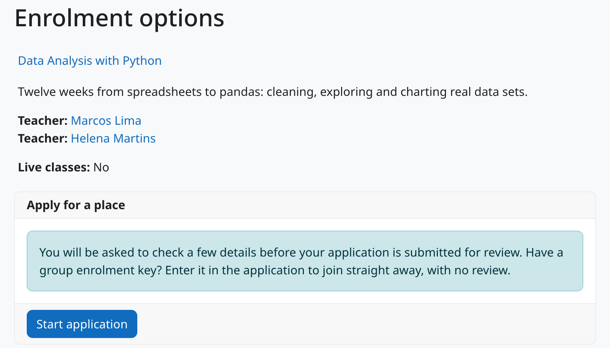
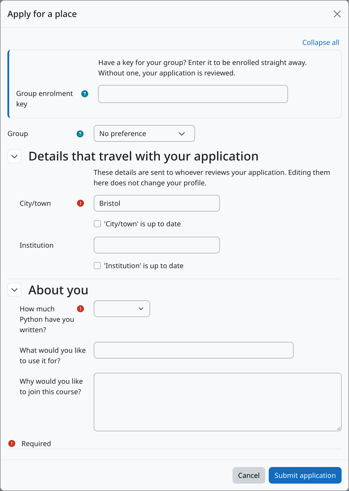
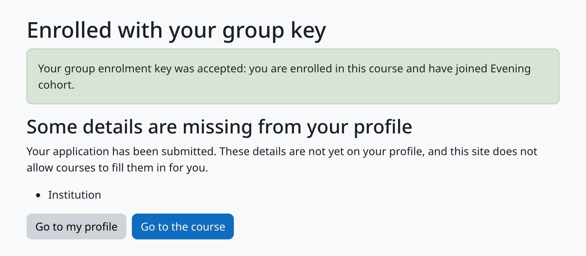
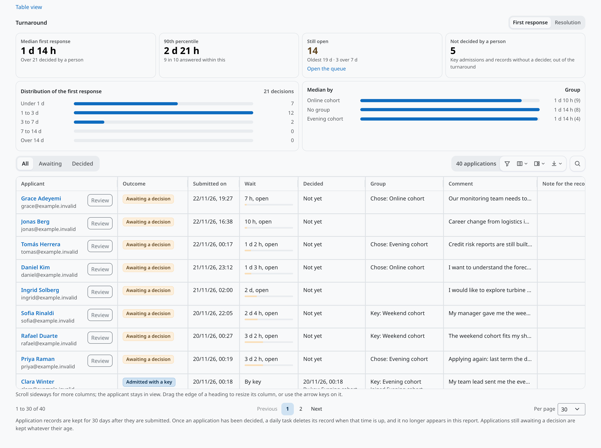
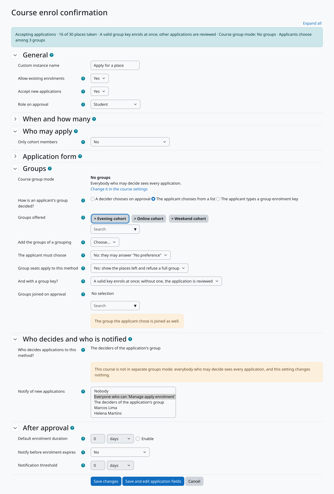

# Enrolment upon approval (`enrol_apply`)

A Moodle enrolment plugin that inserts an approval step into course enrolment. A user
applies for a course, optionally leaving a comment; the enrolment is created suspended,
so it grants no access; a teacher or manager then confirms it, defers it to a waiting
list, or cancels it. Applicants are notified of the decision by message and e-mail.

## Compatibility

| Moodle | Supported | PHP |
|--------|-----------|-----|
| 5.3    | yes       | 8.3 – 8.4 |
| 5.2    | yes       | 8.2 – 8.4 |
| 5.1    | yes       | 8.2 – 8.4 |
| 4.5 and older | no  | — |

Declared in `version.php` as `$plugin->supported = [501, 503]`. CI runs one
moodle-an-hochschulen job per supported branch; the compatibility table and the job list
in `.github/workflows/ci.yml` are updated together with `supported`.

## Features

- Applications are queued for approval instead of enrolling the user immediately.
- A configurable free-text comment field on the application form.
- Optionally collect the standard and the custom user profile fields with the application,
  and ask questions of the method's own (application fields), shown or hidden by an earlier answer.
  A custom profile field is drawn, shown and saved by its own field type, so a type from another
  plugin (for example a state and municipality picker) works as it does on the profile page.
- A waiting list, distinct from a plain pending application.
- Groups an applicant automatically joins **once the application is approved**.
- Optionally, the applicant chooses a group when applying, from the groups the method offers:
  a searchable list in the application form (a plain list without JavaScript), showing only the
  groups the applicant may see and, with `local_groupdist`, the places each has left; a full group
  is shown and cannot be chosen. The choice can be optional ("No preference") or required, and the
  acknowledgement names the group applied for.
- A cap on the number of applicants per instance, and a number of places that the queue
  measures approvals against.
- Optionally, core's group enrolment keys: a valid key enrols the applicant at once, without
  review, in that group (and, with `local_groupdist`, only while every group it joins has a seat),
  either beside the review or as the only way in.
- Notifications to course teachers, to a configurable global recipient list, and to
  mentors holding the capability in the applicant's own user context.
- Enrolment duration with the standard core expiry notifications and expiry action.

## Screenshots

*Moodle 5.1 with the Boost theme and a demo course: one enrolment method asking for two profile
fields and two questions of its own, three groups (two with an enrolment key) and a dozen
fictional applicants. `local_groupdist` is installed, so the groups have seats.*

### Applying

<table>
<tr>
<td valign="top" width="50%"></td>
<td valign="top" width="50%"></td>
</tr>
</table>

The enrolment page offers the method as a card. **Start application** opens the form in a
modal, or on a page of its own without JavaScript: an optional group enrolment key, the profile
details the teacher asked for, each confirmed as up to date, the method's own questions and the
comment.
Editing the details here changes the application, not the profile.



A valid group key enrols the applicant at once, in that group, with no review.

### Deciding


The queue for one method. The panel at the top counts what awaits a decision, what is deferred,
the places taken and the applications held. Each row carries the group its key named, what the
applicant submitted, the comment and a badge where there is something to know: on the waiting
list, applied before, or a valid group key that found no place or seat. The queue filters by group
too. Select rows and decide them together from the bar at
the foot of the page, choosing the groups and the role an approval gives.


**Review** opens one application, with links to the previous and next, and reads top to bottom
in the order a decision asks its questions:

1. **Who, and how.** A strip with the status, what the group key did (*Key accepted: Turma A*) or
   the group the applicant chose (*Chose: Evening A*), how long the application has waited, the
   method, the course and the applicant's identity line. **Already in this course** lists the
   applicant's other enrolments in the course, through any method: its status, the role it gave,
   and for this plugin's methods the groups joined through it and how it was admitted (by a group
   key, or approved on a date, and by whom for a holder of `enrol/apply:viewreports`).
2. **What weighs on the decision.** One line per signal, each with an icon, its number and a word:
   the seats of each group the approval joins that declares seats (with `local_groupdist`), the
   places on the method, the earlier applications to the course (for a holder of
   `enrol/apply:viewreports` only), the details submitted and the comment. A count needs
   *attention* from four fifths of its limit and is *over the limit* at it; a limit that is not set
   gives no line. Nothing here blocks a decision: a full group or method is warned, and the
   decision is yours. A line under them gives the applications held on the method and how many
   are deferred (in your groups, for a decider narrowed by separate groups).
3. **On confirming.** A sentence says who joins the course with which role and in which groups,
   and that they are told, with the seats and places afterwards. **Adjust groups and role** opens
   the groups as cards to tick, with each group's occupancy, and the role. The group the applicant
   chose is ticked on top of the method's groups; untick it or pick another to place them
   elsewhere. With no group ticked the approval uses the method's groups, and for an application a
   key sent for review the key's group, or the group the applicant chose, too; the page names them.
   So does an approval from core's **Edit enrolment** or a bulk approval with no group chosen.
   In a course with more than eight groups you may choose, only the
   approval's own groups are cards and the others are found by typing part of a name or code,
   optionally within one grouping.
4. **A message to the applicant or a note for the record**, behind one disclosure: the message goes
   to the applicant with the decision, the note stays with the record.
5. **The decision**, in the bar at the foot of the page, each button with what it does beside it.
   Cancelling asks first.

The comment, the details submitted and the earlier applications sit in a column of their own,
which the signals link to. A reader who may only view applications gets the strip and the
signals without the seats or places, and no decision.

### The record



Every application the course has recorded, decided ones included, with the outcome of each and
how it was admitted, the group of the key and the groups the approval joined. It filters (by
group too), sorts and downloads as CSV or Excel.

### Setting up the method



Per course, in seven sections, after a one-line summary of a saved method (whether it accepts
applications, the closing date, the places taken and what a group key does): **General** (the
name, **Allow existing enrolments**, **Accept new applications**, **Role on approval**); **When
and how many** (the application window, the maximum applicants, the places and the places taken);
**Who may apply** (the cohort); **Application form** (the **Text shown to applicants**, **Ask for
a comment** and its **Comment prompt**, the profile fields to ask for, and how many questions the
method asks); **Groups** (see below); **After approval** (the enrolment
duration, the expiry notice, the offer to save details to the profile); **Notifications**
(**Notify of new applications**). Who may apply and the last two stay closed unless they hold
something other than the default. **Save and edit application fields** leads on to the method's
own questions.

**Who may apply** also offers, once a cohort is chosen, **Hide this card from people outside the
cohort**: they then see no card for the method on the course's enrolment page (somebody who already
applied always sees theirs). Without it they see the card and are told they may not apply.

**Groups** starts with one question, **How is an applicant's group decided?**

- **A decider chooses on approval**: the applicant names no group; whoever approves picks the groups.
- **The applicant chooses from a list**: **Groups offered** (a group only its members can see is
  marked "never offered", and is never shown to an applicant), **Add the groups of a grouping**
  (copied into the list when you save; a group added to the grouping later is not offered until
  you add it), **The applicant must choose** (or answer "No preference"), **Group seats apply to
  this method** (with `local_groupdist`: the list shows each group's places and refuses a full
  one; off, the method neither shows nor checks seats) and **And with a group key?** (no, or "a
  valid key enrols at once", where a valid key wins over the chosen group). A required choice with
  nothing to offer is refused.
- **The applicant types a group enrolment key**: what the key does (enrol at once, beside the
  review; key only; key only, reviewed), with the groups that carry a key and their seats, never
  the keys.

Then, whatever the answer, **Who decides applications to this method?** ("The deciders of the
application's group", or "Only those who see every group", see [Separate groups](#separate-groups))
and **Groups joined on approval**. In a separate-groups course the section warns when a method
granting a role that decides applications is decided by each group's deciders (a moderator of a
group could approve another moderator), when a group offered here is joined on approval, through
another method of the course, with a role that decides, and which applications reach only those
who see every group (without a group, or with "No preference"). The summary strip says how many
groups the applicants choose among, and when only those who see every group decide.

## Installation

### From the Moodle plugins directory

Site administration → Plugins → Install plugins, then upload the release ZIP.

### With git

```sh
cd /path/to/moodle/public/enrol      # Moodle 5.1 and later keep plugins under public/
git clone https://github.com/uaiblaine/moodle-enrol_apply.git apply
```

Then visit Site administration → Notifications and follow the upgrade steps.

## Configuration

Site-wide settings live under Site administration → Plugins → Enrolments → Course enrol
confirmation: the notification templates for confirmation, waiting list and cancellation
mails, who gets notified about new applications, the expiry behaviour, and the defaults
applied to newly created instances.

Per course, add the "Course enrol confirmation" method under Participants → Enrolment
methods. The pending queue for a course is reachable from the enrolment methods page and,
for whoever may decide or view applications in the course (a moderator who cannot edit
enrolment methods included), from the course's Reports page;
the site-wide queue is at Site administration → Courses → Manage enrolment applications
for site administrators, and at `/enrol/apply/manage.php` for anyone else holding
`enrol/apply:manageapplications` at system level.

### Settings

Every setting is stored per plugin, as `enrol_apply/<name>`:

| Setting | What it decides |
|---------|-----------------|
| `allowedfields` | which profile fields a course may ask for |
| `allowprofilewrite` | whether a course may offer to save the submitted details to the profile (off by default) |
| `queuefilterfields` | which identity fields the applications queue offers as filters |
| `confirmmailsubject`, `confirmmailcontent` | the approval message |
| `waitmailsubject`, `waitmailcontent` | the waiting-list message |
| `cancelmailsubject`, `cancelmailcontent` | the cancellation message |
| `notifyglobal` | who is told about every new application, site wide |
| `retentiondays` | how long an application record is kept (30 days by default, 0 for ever) |
| `expiredaction`, `expirynotifyhour` | what happens when an enrolment period ends, and when expiry notices go out |
| `defaultenrol`, `status`, `newenrols`, `groupkeys`, `opt_commentaryzone`, `maxenrolled`, `places`, `roleid`, `notifycoursebased`, `enrolperiod` | the defaults of a new instance |

### Group enrolment keys

An instance decides what the enrolment key of one of the course's groups does ("What a group
enrolment key does"; the site default for new instances is `enrol_apply/groupkeys`):

- **Nothing** (the default): every application is reviewed, and keys are ignored.
- **A valid key enrols at once**: an applicant with a valid key is enrolled straight away, while
  every other application is reviewed as usual.
- **Key only**: a valid key enrols at once, and nobody can enrol through the method without one.
  Nothing ever waits for a decision there.
- **Key only, reviewed**: the key is just as mandatory, but a valid key sends the application for
  review instead of enrolling: nobody can apply through the method without one.

The key is core's own group enrolment key, set on each group's settings page, the one
`enrol_self` reads; this plugin stores none. Any group of the course counts. The instance form
lists which groups carry a key, never the keys. Everywhere but to the applicant who typed it, a
group is named only to somebody core's group visibility lets see it: a group that is not visible
to everyone is left unnamed for a reader without `moodle/course:viewhiddengroups` who is not one of
its members (a hidden one, for anybody without that capability).

**A valid key enrols at once.** With this mode, the application form starts with an optional
**Group enrolment key**, in a block of its own that says what it does. An applicant who enters a
valid key still fills in every required field and question. On submitting, they are enrolled at
once and join that group (and the instance's own groups), with no review, and go straight into
the course. The enrolment window, the cohort restriction, the applicant limit and the places
still apply: with no place left, the application waits for a review instead, and the applicant
is told why. A wrong key is refused with the choice to send the application for review without
it.

**Key only.** The enrolment page says a key is needed before any form, and its button reads
**Enrol with a key**. The form comes in two steps. The first asks for the key alone, with
**Continue**. Once the key is valid and a place and every seat it would take are free, the second
says "You will join *group*" and asks the rest, submitted with **Enrol me**. A wrong key, no place
left or a full group is said on the first step, so nothing typed is lost, and nothing is ever
written for a refusal. In the modal, the footer's submit button appears only on the second step.
Applications made before an instance was switched to key only stay in its queue and can still be
decided.

**Key only, reviewed.** The form is the one of *Key only*: the enrolment page says a key is needed
and its button reads **Apply with a key**, the first step asks for the key alone, and the second
says "Your application for *group* will be reviewed" and asks the rest, submitted with **Submit
application** (in the modal the footer's label is chosen by the server from the mode, so it never
reads "Enrol me" here). No key, a wrong key, a locked field, no place left or a full group is
refused on the first step and nothing is written. A valid key writes an ordinary application that
waits in the queue, marked **Key accepted, sent for review**, with the key's group recorded; the
applicant reads that the key was accepted and the application waits for review, and is not
enrolled. Three behaviours follow from the record being the promise: approving it (without a group
choice, as the bulk decision does) joins the key's group as well as the method's own list, even if
the key was rotated or removed from the group while it waited or the method changed mode; a group
deleted meanwhile is skipped; and unticking every group in the chooser still applies those
defaults. Pending applications hold no seat, so a group can draw more keyed applications than it
has seats: the decider is warned, never blocked. The managers' new-application notice names the
key's group to a recipient who may see it.

On every mode that reads a key, the key is trimmed of the whitespace the group page never stores. A key ending in
an unusual space, as a copied one often does, gets its own message and costs no try. Wrong keys are
counted per applicant and instance in the `keyattempts` application cache, for 15 minutes. After
five, the field gives way to a sentence for the rest of that time, so the form cannot be used to
guess keys without limit. On a key-only method that also means the form cannot be sent at all
until then. Several sessions of one account are counted together: each request checks the key
under a lock on the applicant and the method, and one that cannot obtain it within a few seconds
is treated as locked. The count is per account: on a site where anybody may create an account, it
does not stop somebody with many accounts, so keys there should not be easy to guess. The key is read
from the database when the application is written, and again once the locks that admit it are held,
so a key rotated on the group's page stops admitting from then on; only a request already past that
second read can still be admitted with the old key.

Who is told what:

- **The applicant** reads "Enrolled with your group key", naming the group, on the course page
  they land on. No "your application was approved" message is sent, since nobody reviewed it. On
  the mode that also takes applications, a valid key that could not admit says why: no place left,
  the group full, or a place that could not be confirmed in time.
- **Managers** (the same people told about new applications) get an informational notice with its
  own subject and a link to the applicant. It names the group only to a recipient who may manage
  applications in the course and may see the group. On a key-only method, where every enrolment is one, the notice is
  sent only when **Tell managers about each enrolment with a key** is set to Yes (off by default).
- **The queue and the review page** mark an application a valid key could not admit. The review
  page names the group to a decider or a viewer who may see it, and ticks the groups the key would
  have joined. The empty queue of a key-only method says nothing waits there.
- **The reports** carry an **Admission route** column and filter (review, or what the key did) and
  the **Group of the enrolment key**, empty for a reader who may not see that group; that column
  cannot be sorted.
- **The teacher configuring a key-only method** is warned, while that mode is selected, when no
  group of the course has a key, when every keyed group is full, and when applications are still
  waiting; on *Key only, reviewed* the same two warnings read "apply" and the third counts only
  the applications without a key, which stay in the queue. Either key mode warns when the course's self enrolment accepts the same group keys,
  which would enrol without these questions.

Two apply methods in one course accept the same keys, whatever their modes.

**Optional: `local_groupdist`.** When it is installed, each group's **Seats** (a group custom field
it provides; empty means no limit, 0 means full) count too. A key admits only while every group the
admission joins (the key's and the instance's own) has a seat. Otherwise the application waits for
a review, or, on a key-only method, the key is refused. The instance form shows each keyed group's
seats. The approval group chooser shows every group's occupancy (a full group can still be chosen:
a person decides). An approval that takes a group past its seats is followed by a warning.
Occupancy is every member of the group, counted as `local_groupdist` counts it. Without it, groups
carry no seats and nothing above applies. It is not declared as a dependency.

### Placeholders in the notification mails

`{firstname}`, `{lastname}`, `{username}`, `{content}` (the course name) and `{timeend}`
(the enrolment expiry date) are replaced when the message is sent.

## Capabilities

| Capability | Grants |
|------------|--------|
| `enrol/apply:config` | add, edit and remove instances |
| `enrol/apply:manageapplications` | decide on applications |
| `enrol/apply:choosedecision` | choose the groups and role an approval gives |
| `enrol/apply:viewapplications` | view the queue and the review page without deciding; the review page also shows the staff-internal note of the last deferral, so grant it to staff only |
| `enrol/apply:viewreports` | read the course's report of applications |
| `enrol/apply:manage` | manage the resulting user enrolments |
| `enrol/apply:unenrol` | unenrol other users |
| `enrol/apply:unenrolself` | unenrol yourself |

`enrol/apply:manageapplications` is honoured at three levels: at system level it covers
every course, at course level that course, and in a user's own user context it covers
that user's applications, which is what allows mentor-style delegation.

`enrol/apply:choosedecision` decides whether a decider picks the groups and role of an
approval. Without it they approve or refuse only: an approval gives what the method gives (the
key's group and the method's groups for an application a group key sent for review, the method's
groups otherwise, and the method's role), the screens show those read-only instead of the
choosers, and the server ignores a posted choice. `enrol/apply:viewapplications` opens the queue
and the review page read-only, for a coordinator who reads applications and decides none: no
selection, no bulk bar, no decision form. Granted at system level it opens the site-wide queue
(`/enrol/apply/manage.php`), read-only; it has no mentor level. Both go to editing teachers and
managers by default, as `enrol/apply:manageapplications` does, so a site that adds neither to a
role sees no change.

`enrol/apply:viewreports` is granted to managers only, and deliberately not to editing
teachers the way the capabilities around it are. The report it opens shows the profile
details every applicant submitted, for every application the course has ever had, decided
ones included and long after the enrolment itself has gone — a wider disclosure than
deciding on the queue in front of you. A site that wants its teachers to have it should
grant it to them on purpose. It carries `RISK_PERSONAL`, so Moodle flags it as such on the
role definition screens.

Which profile details appear is a second, separate question, and the answer is core's:
a reader without `moodle/site:viewuseridentity` in the course sees the applicant's name and
nothing else. The identity fields are not blanked for them, they are absent — no column, no
filter, no sort — because filtering and sorting are database operations and would otherwise
let a reader recover a hidden value by narrowing on it and counting the rows.

The details an applicant submitted follow the same rules on the queue, the review page, the
course report and the approver's e-mail, judged for each reader in the course: the address,
phone numbers, institution and department appear only where *Show user identity*
(`showuseridentity`) names them; a field listed in *Hide user fields* (`hiddenuserfields`), such
as the city or country, needs `moodle/course:viewhiddenuserfields`; and a custom profile field
whose visibility is private or nobody needs `moodle/user:viewalldetails`. To let approvers read a
department they asked for, add it to *Show user identity*.

### Separate groups

In a course whose group mode is **Separate groups**, a decider who lacks
`moodle/site:accessallgroups` there (the stock *Non-editing teacher*, given
`enrol/apply:manageapplications`) decides only the applications of their own groups. This is
core's rule for the participants page, so nothing extra is configured. An application belongs to
the group whose enrolment key the applicant typed, or else to the group the applicant chose from
the method's list. One made with neither ("No preference" included) belongs to no group and
reaches only those who can access all groups. The instance form says so in such a course while
the mode lets keyless applications in: *Nothing* and *A valid key enrols at once*. Such a decider
sees only their groups' applications in the queue and in the previous/next links. The review page
of any other application is refused to them, and they cannot approve, defer or cancel one. Only
their own groups are offered to choose from. They are told of a new application only when it is
in one of their groups. They get the decision icon on the participants page only for those. A
decider in no group gets core's "you need to be part of a group" notice instead of a queue. Core's
**Edit enrolment** screen (`enrol/apply:manage`) is refused to them too when it would approve an
application outside their groups, and so is core's **Unenrol** route for a pending application outside
their groups. A moderator in separate groups should decide from the approval queue, not from the
participants page: core lists a separate-groups teacher only the members of their own groups, and
an applicant joins a group only when approved, so an applicant is rarely listed there for them. When
they do reach the bulk decision, its confirmation says how many of the selected applications are
outside their groups and will be left alone. *Visible groups* and *No groups* narrow nobody. A holder of the
capability at system level and a mentor (the capability in the applicant's own user context) are
never narrowed, as their delegation does not come from the course.

The queue says whose application each row is. A **Group** column names the group of the key the
applicant typed or the group they chose (or *Without a group*), on a course's queue and on the site-wide one, never on a
mentor's; a group core hides from the reader leaves the cell blank. A **Group** filter, on a
course's queue only, offers the groups the reader may see in natural order (a search above eight),
plus *My groups* and *Without a group* for a reader who sees every group; a narrowed decider is
offered their own groups and nothing else, and the server ignores any other value they send. A
narrowed reader is told which groups their queue shows (*You see the applications of: ...*), and
the status control's counts (*All*, *Pending*, *Deferred*) are their groups', while the method's places and
applications held stay the method's and say so. In a *Visible groups* course the filter starts on
the reader's own groups, as a filter they can remove, never as a restriction.

Two refinements, for courses where moderators are recruited through the plugin itself. A method
whose **Who decides applications to this method?** is *Only those who see every group* gives a
narrowed reader none of its applications, whatever their group: not in the queue, on the review
page, in the previous/next links, in the choosers, in the new-application notice or in the course
report. And a group membership this plugin wrote on approval narrows a decider to that group only
when the role the same method gave them decides applications in the course (holds
`enrol/apply:manageapplications` there): somebody who studies in Evening A through a student method
and moderates Morning C through a recruitment method decides Morning C's applications alone. A
membership made by hand, or by another plugin, counts as core counts it.

A holder of `enrol/apply:viewapplications` is narrowed by the same rule, and so is a holder of
`enrol/apply:viewreports` on the course report: in a separate-groups course, without
`moodle/site:accessallgroups`, the report lists only the records whose key group or chosen group
is one of theirs or whose approval joined one of their groups (for an approval recorded before version
2026110505 whose memberships the upgrade could not find, the groups the decider chose), and a
reader in no group sees no row and core's notice. Each capability's own system-level grant lifts its narrowing. The site-wide
custom-report source is not narrowed: who reads a custom report is decided by its audiences.

### Setting up a group moderator

A moderator decides the applications of their own groups and nobody else's:

1. In the course, set **Group mode** to **Separate groups**, and give the method a mode that
   records a group: *Key only, reviewed* sends every application through a group key.
2. **Site administration → Users → Permissions → Define roles → Add a new role**, with
   **Role archetype** *Non-editing teacher* (which does not hold
   `moodle/site:accessallgroups`). Allow `enrol/apply:manageapplications`. Allow
   `enrol/apply:choosedecision` only if the moderators should pick the groups and the role an
   approval gives (and then they pick among their own groups only). For a read-only coordinator
   allow `enrol/apply:viewapplications` instead of `enrol/apply:manageapplications`.
3. Do not allow `moodle/site:accessallgroups`: it is what lifts the narrowing.
4. `enrol/apply:manage` and `enrol/apply:unenrol` are not needed. Core's **Edit enrolment** and
   **Unenrol** routes refuse a moderator an application outside their groups anyway, but leaving
   both out keeps the role to this plugin's own screens.
5. Assign the role in the course and add each moderator to their groups.

### Recruiting moderators

Moderators can apply through the plugin too, with a second method in the same course whose role
makes them deciders. Set up the moderator role first ([Setting up a group
moderator](#setting-up-a-group-moderator), steps 2 and 3), then add a second **Course enrol
confirmation** method beside the students' one, set differently in five places:

1. **General**: a name the candidates recognise ("Apply as a moderator") and **Role on approval**
   the moderator role. The role is what makes this a *deciding* method.
2. **Who may apply**: the cohort of the candidates ("Moderator candidates"), and **Hide this card
   from people outside the cohort**. Filling the cohort needs `moodle/cohort:assign`, or a
   rule-based cohort.
3. **Groups**: either a decider places the moderator on approval, or the candidates choose among
   the groups they would moderate (never the moderators' own group). Switch **Group seats apply to
   this method** off, so a moderator takes no student's seat.
4. **Who decides applications to this method?**: *Only those who see every group*, so no moderator
   decides on another (the form warns until it is set).
5. **Groups joined on approval**: the moderators' own group, if they have one. **Notifications**:
   the coordination only.

The two methods hold each other in check. Somebody with a moderator application waiting, or
approved, cannot apply through the students' method ("You have applied to take part in this course
in another role, so you cannot apply here."). The other way round is open: a student may apply to
moderate, and the review page shows their student enrolment. A group membership the students'
method gave them never makes them a decider of that group.

A student already enrolled in the course never sees the recruitment card: Moodle sends anybody
enrolled straight to the course. Send them the method's own form instead,
`/enrol/apply/apply.php?instance=<id>` (the method's id is in the **Edit** link of the enrolment
methods page).

## The applications report

Course → Participants → Enrolment methods carries a report icon beside each Course enrol
confirmation method, and the course settings navigation carries the same link. It lists
every application the course has recorded — who applied, when, the comment, the profile
details submitted, the outcome, whether a group enrolment key admitted it, the groups the
approval joined, who decided it and when — with per-user filters, sorting,
paging and a CSV or Excel download.

**Groups joined** names the groups the last approval left the applicant in through the method,
whether the decider chose them or the method's defaults applied. A group the reader may not see is
left out (a cell whose groups are all hidden is blank), and so is a group deleted since. Approvals
recorded before version 2026110505 show the groups the upgrade could find from the applicant's
memberships, and nothing where it found none. **Group chosen** names the group the applicant
chose from the method's list, beside **Group of the enrolment key**; neither is sortable, and a
group the reader may not see leaves the cell blank. Where the course has groups, a **Group
(applied for or joined)** filter selects the applications of one group: its key group or chosen
group, or a group the approval joined. It offers the groups the reader may see, in natural order, and a reader narrowed
by separate groups only their own.

Where a course carries more than one Course enrol confirmation method, the report opens scoped to
the one whose icon you clicked, clearing the method filter widens it to every application in the
course, and each method remembers your filters separately. A course with a single method offers no
such filter, and its report lists that course's applications as it always did.

## Site-wide custom reports

Site administration → Reports → Report builder offers **Enrolment applications** as a report
source, for building ad-hoc reports across every course. It adds a course filter and a course
name column that the course report deliberately does not have. It carries the **Groups joined**
column too, with the same visibility rule, but no group filter: a site-wide list of every group is
unbounded, and a filter by group name would let a reader find the applications of a group whose
name the cell withholds from them.

The profile details an applicant submitted appear here only for a reader holding
`moodle/user:viewalldetails`, and for anyone else the column is absent rather than empty — it
cannot be added to a report, filtered or sorted. That is a deliberately different gate from the
course report's, because a custom report has no course to ask about and no permission check of
this plugin's on it at all: who may read one is decided by Moodle's report capabilities and by
the report's audience.

Two consequences worth knowing before relying on it. A report can be shared with an audience
wider than the person who built it. And a **scheduled** report is rendered once using its
creator's permissions and then mailed to every recipient, so what arrives in an inbox reflects
what the creator may see, not what the reader may.

Nor is this source narrowed by separate groups, as the course report is: it spans courses with
different group modes, so a site that must keep one group's applications from another group's
moderator gives such a report no audience that includes them.

This surface follows the site's `Enable custom reports` setting. The course report does not —
it keeps working when custom reports are switched off.

### Large exports, and exports on a schedule

Both reports download synchronously, and that is deliberate rather than a limitation to work
around. Moodle's export path sets no time limit and streams rows one at a time rather than
loading them all, so a large export takes longer but does not run out of time or memory.

If you want an export to arrive **on a schedule** rather than on demand, build a custom report
on the Enrolment applications source and use Report builder's own scheduling: Moodle produces the
file, mails it and cleans it up, with nothing needed from this plugin.

One limit worth knowing before planning around it: Moodle can only schedule **custom** reports,
and who may edit them is decided at site level. So a course manager cannot be given a recurring
export of their own course's applications without also being given site-level report permissions.
For a one-off, the course report's own download is the answer.

### Setting up a mentor

A mentor is somebody who decides on the applications of specific users, wherever those
users apply, without holding the capability in the course or at system level. Moodle's
standard mentor pattern configures this in three steps:

1. **Site administration → Users → Permissions → Define roles → Add a new role.** Give it
   a name such as "Application mentor" and allow `enrol/apply:manageapplications`.
2. On the same form, under **Context types where this role may be assigned**, tick
   **User**. Without this the role cannot be attached to a person.
3. Open the mentee's profile and use **Preferences → Roles → Assign roles relative to
   this user** to give the mentor that role.

The mentor then opens `/enrol/apply/manage.php` with no parameters, sees exactly those users'
applications there, and can decide on them. (The Site administration menu entry is only shown to
site administrators.)

One limitation is worth knowing before you rely on it. A Moodle capability declares a
single context level, and this one declares `CONTEXT_COURSE`; the user-context override
screen lists only capabilities declared at `CONTEXT_USER`, so this capability does not
appear there. Defining and assigning the role works exactly as described above — what you
cannot do is override the capability for one individual mentee. Core lives with the same
constraint for `moodle/grade:viewall`, which its own declaration marks as
"CONTEXT_COURSE // and CONTEXT_USER".

## The record of an application

Every application leaves a durable record in `enrol_apply_submission`: what the applicant
wrote, the profile details they entered, the decision taken, who took it and when, and, when
a group enrolment key was entered, which group's key it was and what it did (admitted without
review, or left the application waiting because no place or seat was left; the key itself is
never stored). The pending comment in `enrol_apply_applicationinfo` is deleted on approval, on
cancellation and on unenrolment — deferring an application to the waiting list keeps it, because
the application is still awaiting a decision. This record survives all four, and **deleting the
enrolment method does not remove it either**.
Removing an enrolment method is a change to the course's configuration; the record of who
applied and what was decided is not part of that configuration.

Three things do end it:

- **Deleting the course.** The records are kept but stripped of everything personal: both
  user ids are zeroed and the comment and profile snapshot are emptied, leaving only the
  dates and the outcome. This happens before the course context is destroyed, because
  afterwards no subject access or erasure request could reach the rows at all.
- **An erasure request**, differently for each of the two roles. A record the person
  *submitted* goes outright: erasure wins over permanence here on purpose, because the trail
  exists to tell a manager what was decided, not to be evidence against the person it
  describes. A record they merely *decided* keeps everything except their name — the record
  belongs to the applicant and carries the applicant's own words, so erasing the decider must
  not take somebody else's data with it.
- **The retention period.** *Site administration ▸ Plugins ▸ Enrolments ▸ Course enrol
  confirmation* offers **Keep application records for**, 30 days by default. A daily scheduled
  task deletes records older than that — decided or abandoned alike, because an application
  nobody ever looked at is exactly the kind that would otherwise be kept forever. The one
  exception is a record whose application is **still in the queue**: nothing expires a pending
  application, so age alone does not make it finished, and deleting its record would leave the
  decision taken later with nothing to record it against. Set the period to zero to keep
  everything forever.

Two consequences worth knowing before you rely on a backup:

- A record travels **only when the backup includes users** — and which switch decides that
  depends on how the backup was made. A manual backup is governed by the wizard's *Include
  enrolled users* checkbox, defaulted from *Site administration ▸ Courses ▸ Backups ▸ General
  backup defaults*. The recycle bin is not: it backs up in automated mode, so the switch that
  governs it is *Automated backup setup ▸ Include users*. Turn that one off and a course that
  goes through the recycle bin comes back without its application records.
- A record travels **only while its enrolment method still exists**. Backup data for an
  enrolment plugin is written per enrolment method, so a record kept after the method was
  deleted has nothing to attach itself to and stays behind. It is still on the site, still
  reachable by a privacy request and still swept by the retention period — it simply does not
  follow the course into a copy.

### Audit trail

The record keeps the last decision only, and is swept after the retention period. Every decision
is also logged, as an event in the site's log store, for as long as the log keeps its rows:

- **Enrolment application approved** (`\enrol_apply\event\application_approved`), once per
  approval, whichever page it was taken on: the queue, the review page, the participants page's
  bulk operation, or core's *Edit enrolment*. It is logged after the enrolment has been written
  and is active on every route, so a save that fails leaves no approval in the log. A group
  key's admission logs *Applicant enrolled with a group key* instead.
- **Enrolment application deferred** (`application_deferred`), when the application moves to the
  waiting list, or when the decider writes the applicant a message about an earlier deferral. A
  correction of the internal note alone logs nothing, as it notifies nobody.
- **Enrolment application cancelled** (`application_cancelled`), once per application cancelled.

Each names the decider as the user, the applicant as the affected user, the course as the
context and the application record as the object. Its `other` carries ids and flags only: the
enrolment method, the user enrolment, the group whose key was entered (0 for none), and for an
approval the groups joined, the role given (0 for none) and whether the decider chose them; for a
deferral whether the enrolment moved and whether there was a message. Never the message, the
decision note, or a group or role name.

They can be read in core's log report (*Course ▸ Reports ▸ Logs*) or through a custom report on
the log source. The log report's group menu filters by the group of the user who acted, not of the
applicant, so it does not list the decisions about one group's applicants; the applications
report is the place for that.

## Data stored

Five tables. Three hold personal data:

- `enrol_apply_applicationinfo` — the comment written with an application still awaiting a
  decision, keyed by the user enrolment. Deleted on approval, on cancellation, on unenrolment,
  with the enrolment method and with the course.
- `enrol_apply_submission` — the durable record of each application: the applicant, the comment,
  the decision, its message to the applicant, the decider's note, the groups and role chosen, the
  groups the approval actually joined, who decided and when, the group whose enrolment key was
  entered with what it did (never the key), and the group the applicant chose from the method's
  offer. Kept for the retention period (`enrol_apply/retentiondays`, 30 days by default; a record
  still in the queue is never swept), pseudonymised when the course is deleted, and kept when the
  enrolment or the method is deleted. See "The record of an application" above.
- `enrol_apply_answer` — what the application submitted: one row per profile field and per
  question asked, with the question as it read at submission. Removed with its record, by every
  route that removes one.

Four are configuration and name nobody: `enrol_apply_groups` (the groups an approved applicant
joins, per method), `enrol_apply_offer` (the groups an applicant may choose from, per method),
`enrol_apply_options` (a method's options that have no column on the enrolment method itself; a
method without a row uses the defaults) and `enrol_apply_fieldcond` (when a question is shown). All
four are deleted with the method.

An approval also writes core rows: a role assignment and group memberships stamped with
`enrol_apply`, and the enrolment itself. The plugin never writes the applicant's profile unless
the site allows it (`enrol_apply/allowprofilewrite`) and the applicant accepts the offer. A custom
profile field is checked again by its own type when the offer is accepted, so a value that must be
unique and was taken by somebody else in the meantime is not written.

## Privacy

The plugin implements the full privacy API — metadata, data export, and deletion for a
user, for a list of users, and for a whole context — over its three personal-data tables and
the group memberships its approvals add.

- **A data export** gives the applicant their pending comment, every application record they
  submitted with the details and answers it carried and the decision taken on it, and the groups
  an approval added them to. Somebody who decided applications gets each decision they took,
  never the applicant's comment or answers.
- **A deletion** removes the applicant's comments, records and answers and the group memberships
  approvals gave them in the course; for a decider it only clears their name from the records,
  which stay the applicant's. Role assignments and the enrolment itself are core's, covered by
  core's own privacy providers.

The decision events (see "Audit trail") are rows of the site's log store, declared by the log
store's own privacy provider, so the plugin declares nothing for them. Core's standard log store
exports the rows a person performed or was affected by, but on an erasure request deletes only
the rows that person performed: an applicant's erasure removes their application record and
keeps the log lines about decisions on it, until the log's own lifetime
(`logstore_standard | loglifetime`, never by default) removes them, whatever **Keep application
records for** says. Core's own enrolment events behave the same way. This is why the events carry
ids only.

## Development

See `CLAUDE.md` for the architecture notes and the local development commands.

```sh
mdl ci moodle-enrol_apply --matrix # every CI leg, locally
mdl phpunit m502 enrol_apply
mdl behat m502 @enrol_apply
```

## Credits

Originally written by [emeneo](http://emeneo.com/) and contributors, with substantial
work by Johannes Burk (sudile GbR), Romain Deleau (IMT Lille Douai), Esdras Caleb and the
community translators of the earlier releases. This fork continues from
[emeneo/moodle-enrol_apply](https://github.com/emeneo/moodle-enrol_apply).

## Translations

The package ships English only, as the Moodle plugins directory requires. Translations reach
sites through [AMOS](https://lang.moodle.org/), Moodle's translation platform. The repository
keeps a Brazilian Portuguese pack in `lang/pt_br` for development; it is left out of the release
package and is contributed to AMOS instead.

## License

GNU GPL v3 or later; see `LICENSE`.
